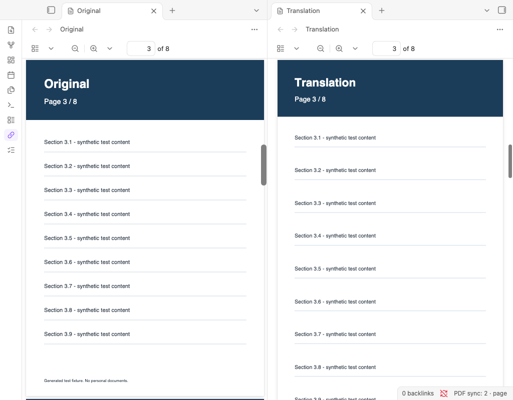
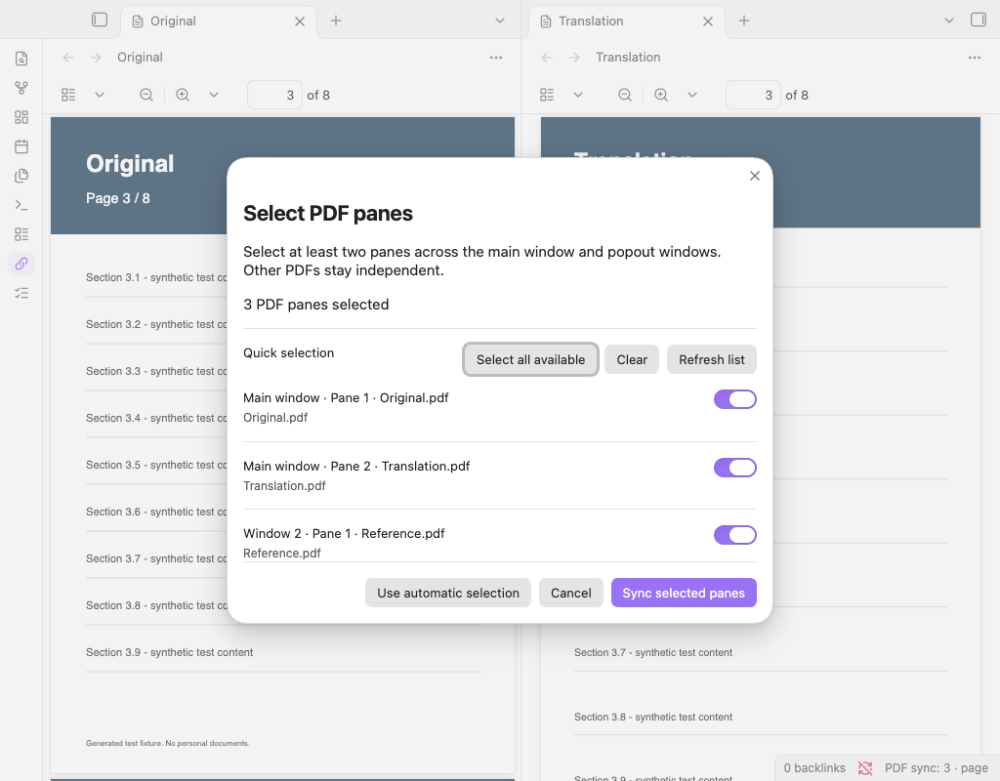

# PDF Sync Scroll · PDF 同步滚动

让 Obsidian 中的多个 PDF 阅读区同步滚动，适合对照原文和译文、不同版本或参考材料。支持分栏和同一笔记库中的独立弹出窗口。

[English](README.md) · [兼容性报告](docs/compatibility.md) · [发布操作指南](docs/publishing.zh-CN.md)

## 功能

- 按页码和页内位置同步，支持不同页面尺寸和缩放比例。
- 按整份文件可滚动距离的百分比同步。
- 暂停后分别定位，再手动建立对应位置。
- 手动选择两个或更多阅读区，同一文件在不同阅读区打开也能分别选择。
- 任一所选阅读区可带动整组；未选中的 PDF 不参与。
- 跟随 Obsidian 的语言：中文语言设置显示简体中文，其余语言显示英文。

## 安装要求

桌面版 **Obsidian 1.14.4 或更新版本**。本次实测基线为 macOS 上的 1.14.4；没有声称已验证 Windows、Linux、旧版本或未来版本。暂不支持手机和平板。

每个 PDF 必须使用**纵向连续滚动、单页显示（不展开双页）**。不支持横向、网格/换行、非连续单页滚动及双页展开。

## 安装

[Obsidian 社区条目](https://community.obsidian.md/plugins/pdf-sync-scroll)已发布。2026 年 10 月 17 日提交时自动审核仍在进行，当前状态请以社区页面为准。安装文件也可从 [GitHub Releases](https://github.com/chmod777h/pdf-sync-scroll/releases) 下载。

1. 在笔记库的配置目录中建立 `plugins/pdf-sync-scroll` 文件夹，默认完整路径为 `.obsidian/plugins/pdf-sync-scroll`。
2. 将同一版本的 `main.js`、`manifest.json`、`styles.css` 放入该目录。
3. 重新加载 Obsidian，在第三方插件设置中允许并启用 **PDF Sync Scroll**。

从原本的本地版本升级时，先备份旧目录，只替换这三个文件，保留 `data.json`。插件标识和命令标识没有改变；若阅读区被重建，可能需要重新选择窗口。

## 使用

默认打开恰好两个可用的 PDF 分栏后会自动连接。滚动其中一个，另一个会跟随。点击左侧链条图标或右下角同步状态，可以暂停或恢复。

打开三个或更多 PDF 时，点击左侧列表图标或运行「选择参与同步的 PDF 窗口」命令，勾选至少两个阅读区，然后点击「同步所选窗口」。也可以右键点击同步状态打开选择窗口。

在设置中切换「按页码和页内位置」或「按整体阅读进度」。设置项可通过 Obsidian 的设置搜索找到。

### 有封面差异时如何对齐

1. 暂停同步。
2. 分别滚动各 PDF 到对应内容。
3. 运行「以当前各窗口的位置重新对齐」命令。

此时会记住各阅读区的相对偏移，并恢复同步。「重置对齐」会清除偏移。偏移只在当前连接期间有效：组成员变化、隐藏后重新加入、暂停后恢复、模式切换、更换文件或重启会重置，需要时重新对齐。

## 范围和限制

- 自动模式只连接恰好两个可用的可见 PDF；更多阅读区需要手动选择。
- 手动模式下，关闭、隐藏或替换所选文件不会自动拉入其他文件；剩余少于两个所选阅读区时等待。
- 保存的选择包含阅读区标识和文件路径。恢复同一工作区可能保留选择；重建阅读区后可能需要重选。如果应用不再提供原有阅读区标识，插件会使用安全的会话标识，此时重启后必须重选。
- 同一时间只支持一组同步，不跨笔记库或不同应用实例。
- 不识别文字含义，不自动推断增删页；页数不一致时可使用进度模式或手动对齐。
- 不要让另一个滚动同步插件同时控制这些阅读区。
- PDF 阅读器结构属于应用内部实现，未来 Obsidian 更新可能需要适配插件。

## 隐私

插件不联网，不收集遥测，不需要账号或付费服务，不读取 PDF 正文，不修改 PDF 文件，也不读取笔记库以外的文件。它读取阅读区的几何位置和滚动位置。模式、开关、所选阅读区标识及文件路径保存在本地 `data.json` 中，发布时应排除该文件。

## 开发与维护

完整源代码就是 `main.js`，无需编译。使用 Node.js 22+ 和 pnpm 11.25.0，执行 `pnpm install --frozen-lockfile`，然后执行 `pnpm verify`，可完成语法检查、官方 JavaScript 规则检查、回归测试和发布文件整理。

[兼容性报告](docs/compatibility.md)记录实测结果与未验证范围。[发布指南](docs/publishing.zh-CN.md)说明 GitHub 与社区提交步骤。

使用 [MIT 许可证](LICENSE)。维护者：[chmod777h](https://github.com/chmod777h)。
